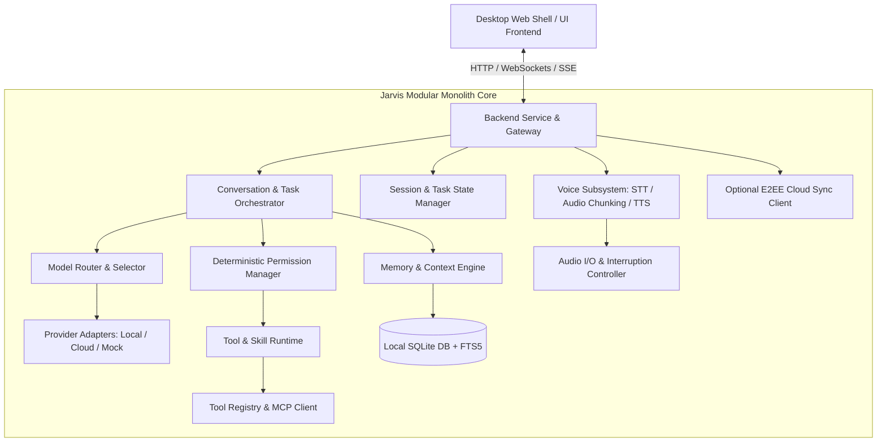
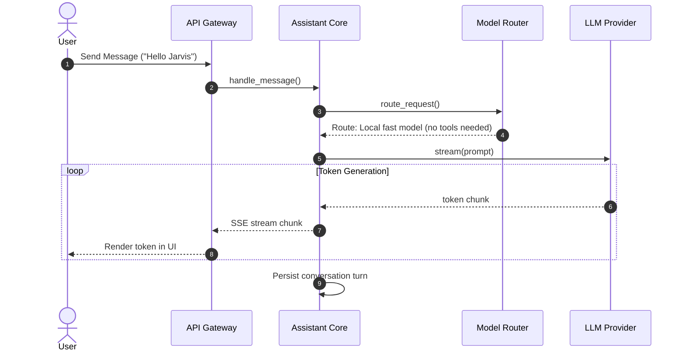
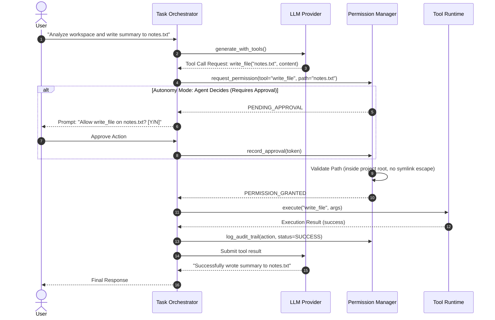
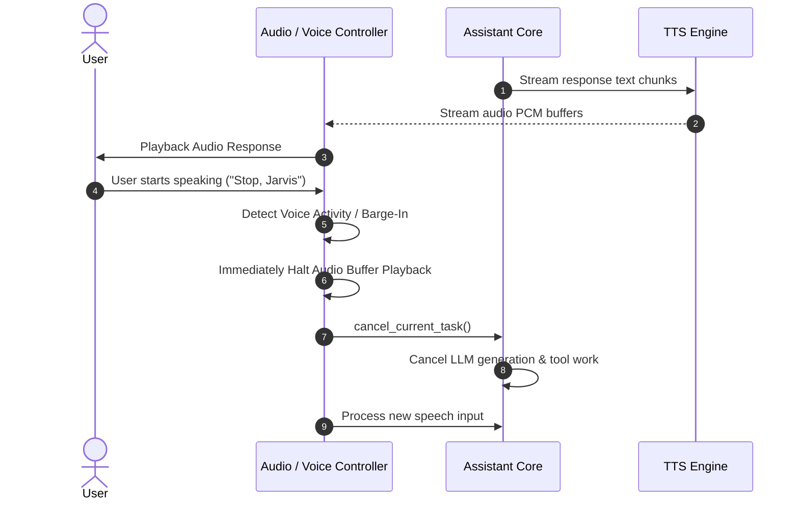

# Jarvis — System Architecture Document

## 1. Architectural Style: Modular Monolith

Jarvis is architected as an extensible **modular monolith**. This avoids the operational complexity, serialization overhead, network latency, and deployment failure modes of microservices, while enforcing strict encapsulation between logical subsystems via typed contracts and explicit interfaces.



---

## 2. Subsystem Decompositions & Responsibilities

### 2.1 Interface & Desktop Layer (`src/jarvis/server`)
- Exposes REST, Server-Sent Events (SSE), and WebSocket endpoints.
- Lightweight, self-contained desktop UI served directly from FastAPI / Starlette, accessible via browser or embedded WebView / Tauri.
- Provides real-time event streaming for tokens, tool execution progress, speech waveforms, permission prompts, and system telemetry.

### 2.2 Core Orchestration & Session (`src/jarvis/core`)
- **Conversation Manager**: Handles conversational turns, history management, and direct fast-path routing.
- **Task Orchestrator**: Executes bounded workflows for tool-assisted requests. Maintains execution budgets (max steps, timeouts, recursion depth).
- **Session Manager**: Manages active sessions, serializes conversation state, and enables seamless task resumption after application restart.

### 2.3 Provider Adapters & Capability Registry (`src/jarvis/providers`)
- **Normalized Contract**: Standardized abstraction (`BaseLLMProvider`) supporting `generate()`, `stream()`, `embed()`, and capability introspection.
- **Adapters**:
  - `LocalProvider`: Connects to Ollama, LM Studio, llama.cpp, or custom local OpenAI-compatible endpoints.
  - `HostedProvider`: Configurable adapters for OpenAI, Anthropic, Gemini, OpenRouter.
  - `MockProvider`: High-fidelity, deterministic in-memory provider for automated tests and offline simulation.
- **Capability Registry**: Dynamically discovers and tracks model capabilities (tool use, JSON schema, vision, max context, streaming latency).

### 2.4 Model Selection & Intelligent Router (`src/jarvis/routing`)
- Evaluates incoming prompts against policies (Local, Hybrid, Cloud).
- Analyzes complexity, required tools, and context window requirements.
- Generates transparent, human-readable explanations for routing decisions without leaking internal chain-of-thought.

### 2.5 Deterministic Permission Enforcement (`src/jarvis/security`)
- **Permission Engine**: The sole authoritative gate for executing any external action or tool.
- Evaluates autonomy modes (`Plan`, `Agent Decides`, `Auto`, `Sandbox Only`).
- Enforces strict path boundaries (resolving real paths, preventing symlink escapes and traversal).
- Maintains tamper-evident audit logging for all attempted and completed actions.

### 2.6 Tool, Skill & MCP Runtime (`src/jarvis/tools`)
- **Tool Registry**: Strongly typed Pydantic parameter schemas, execution preconditions, permission tags, and timeouts.
- **Built-in Tools**: Safe file reading/writing (path-restricted), web search abstraction, computer inspection, system diagnostics.
- **Skill Engine**: Declarative YAML/JSON skill manifests defining multi-step workflow prompts and required tools.
- **MCP Client**: Standardized connector supporting Model Context Protocol tool definitions.

### 2.7 Tiered Memory & Context Engine (`src/jarvis/memory`)
- Local SQLite database with Write-Ahead Logging (WAL) and automated migrations.
- Categories: Working memory, User profile/preferences, Episodic task history, Procedural recipes.
- Hybrid retrieval: Fast BM25 full-text search (SQLite FTS5) coupled with optional embedding vector distance ranking.
- Context budgeting: Automatically summarizes old turns to stay safely within model token limits.

### 2.8 Voice & Audio Subsystem (`src/jarvis/voice`)
- **Speech-to-Text (STT)**: Streaming audio capture and chunk transcription via local Whisper/faster-whisper or test mock.
- **Text-to-Speech (TTS)**: Chunk-level neural TTS generation (Kokoro-82M / Piper).
- **Interruption Manager**: Asynchronous event listener capable of aborting active audio playback and backend generation upon detecting user voice activity (barge-in).

### 2.9 Optional Cloud Sync (`src/jarvis/sync`)
- Completely decoupled from LLM inference.
- Client-side AES-GCM encryption of preferences, memories, and skills before transmission.
- Offline-first synchronizer with deterministic conflict resolution (field-level timestamping/vector clocks).

---

## 3. Data Flows & Sequence Diagrams

### 3.1 Fast-Path Conversational Request


### 3.2 Bounded Tool Execution with Permission Gate


### 3.3 Voice Pipeline with Barge-in Interruption


---

## 4. Key Data Contracts & Schemas

### 4.1 Message & Role Schema
```python
class MessageRole(str, Enum):
    SYSTEM = "system"
    USER = "user"
    ASSISTANT = "assistant"
    TOOL = "tool"

class ChatMessage(BaseModel):
    role: MessageRole
    content: str
    name: Optional[str] = None
    tool_calls: Optional[List[ToolCall]] = None
    tool_call_id: Optional[str] = None
    timestamp: datetime = Field(default_factory=datetime.utcnow)
```

### 4.2 Tool Execution & Schema
```python
class ToolDefinition(BaseModel):
    name: str
    description: str
    parameters_schema: Dict[str, Any]
    requires_permission: bool = True
    read_only: bool = False
    timeout_seconds: float = 30.0

class ToolCall(BaseModel):
    id: str
    tool_name: str
    arguments: Dict[str, Any]

class ToolResult(BaseModel):
    tool_call_id: str
    status: Literal["success", "error", "rejected"]
    output: Any
    error_message: Optional[str] = None
```

### 4.3 Permission Policy Schema
```python
class AutonomyMode(str, Enum):
    PLAN = "plan"
    AGENT_DECIDES = "agent_decides"
    AUTO = "auto"
    SANDBOX_ONLY = "sandbox_only"

class PermissionRequest(BaseModel):
    request_id: str
    tool_name: str
    action_type: Literal["read", "write", "delete", "execute", "network"]
    resource_path: Optional[str] = None
    parameters: Dict[str, Any] = Field(default_factory=dict)
    justification: str

class PermissionDecision(BaseModel):
    request_id: str
    allowed: bool
    requires_user_prompt: bool
    reason: str
```

---

## 5. Storage & Persistence Architecture

- **Engine**: SQLite 3 with Write-Ahead Logging (`PRAGMA journal_mode=WAL;`), Foreign Keys enabled (`PRAGMA foreign_keys=ON;`), and synchronous normal mode for high throughput.
- **Location**: Strictly confined to `<workspace_root>/data/jarvis.db`.
- **Migrations**: Lightweight schema version table (`schema_migrations`) executing transactional DDL updates on startup.
- **Tables**:
  - `sessions` / `messages`: Chat histories, token metrics, metadata.
  - `tasks`: Active and archived task states, step counts, checkpoint payloads.
  - `memories`: Structured user facts, episodic experiences, categories, confidence, timestamps.
  - `audit_logs`: Cryptographically chained or append-only audit trail of all security decisions and executed actions.
  - `settings`: Assistant identity, provider configurations, privacy preferences.
